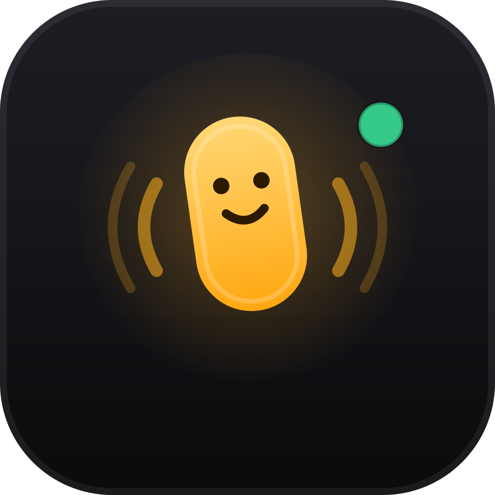
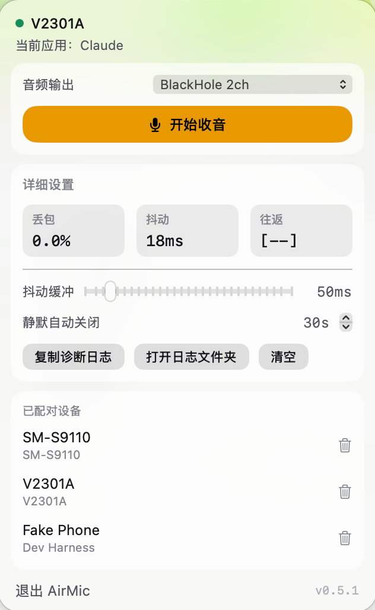
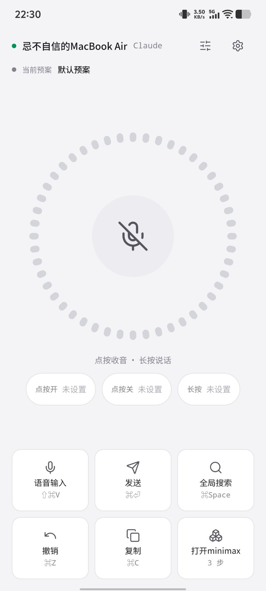
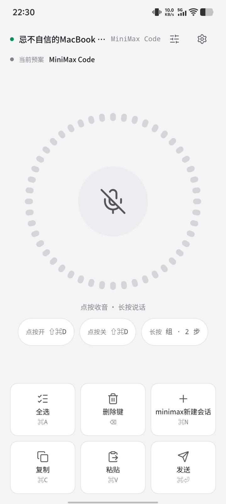
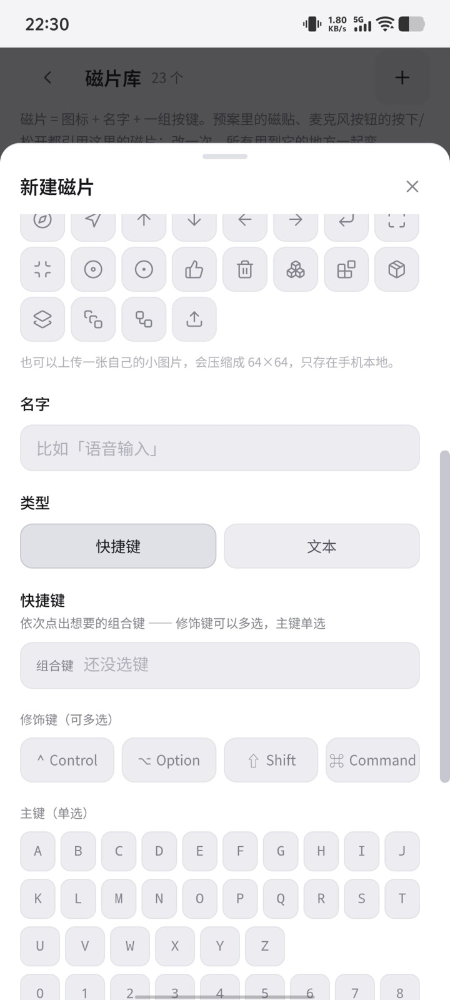
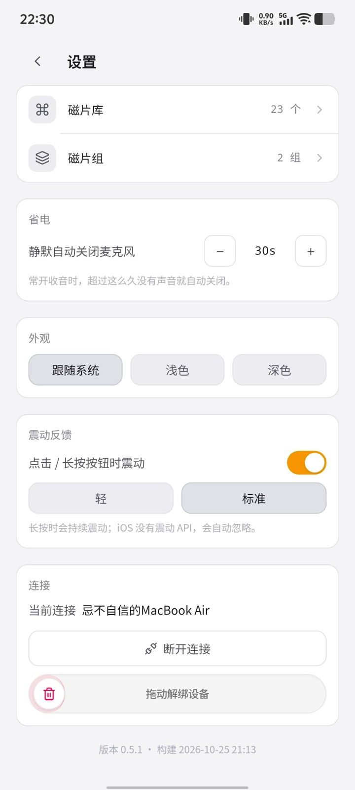
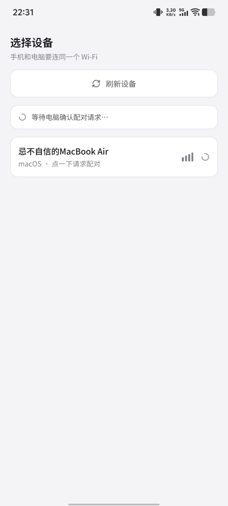
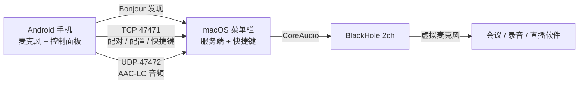

<div align="center">



# AirMic

**把手机麦克风变成电脑麦克风，也把手机变成电脑遥控器。**

手机负责收音和操作，电脑负责出声和执行快捷键 —— 局域网内直连，不经过任何服务器。

[](../../releases/latest)
[](../../releases/latest)
[](../../releases/latest)
[](#隐私)
[](#隐私)
[](LICENSE)

[下载](#下载与安装) · [使用指南](#使用指南) · [常见问题](#常见问题) · [从源码构建](#从源码构建) · [协议文档](shared/protocol.md)

</div>

---

<div align="center">
<table>
  <tr>
    <td align="center"><br><sub>macOS 菜单栏面板</sub></td>
    <td align="center"><br><sub>麦克风页</sub></td>
    <td align="center"><br><sub>预案随前台应用切换</sub></td>
  </tr>
</table>
</div>

## 它能做什么

- **手机当麦克风**：手机采集的声音经局域网实时传输到电脑，写进 BlackHole，会议、录音、直播软件直接把它当麦克风用。
- **手机当遥控器**：手机底部 3×2 磁贴对应电脑快捷键，点一下执行，长按按住不放（自动连发）。
- **按应用切换预案**：电脑前台切到微信 / 浏览器 / 剪辑软件，手机自动换成对应的一套磁贴和麦克风绑定。
- **文本磁片**：磁片里可以存一段提前写好的文字，触发时电脑直接粘贴到当前输入框，支持多行和中文。
- **磁片组**：多个快捷键按顺序、按间隔执行；也可以绑到麦克风长按上（第一步按住，松手后执行其余步骤）。
- **熄屏保活**：手机锁屏后仍和电脑保持连接（只有一条低优先级通知，不收麦克风），回来直接说话；后台闲置 30 分钟 / 1 小时 / 2 小时或永不自动断开，可在设置里选。
- **省电**：静默 30 秒自动停止收音（可调）；收音和连接都跑在前台服务里，锁屏后不会被系统冻结。

## 预览

<div align="center">
<table>
  <tr>
    <td align="center"><br><sub>预案</sub></td>
    <td align="center"><br><sub>快捷键 / 文本磁片</sub></td>
    <td align="center"><br><sub>设置</sub></td>
    <td align="center"><br><sub>配对</sub></td>
  </tr>
</table>
</div>

## 工作方式



| 通道 | 端口 | 内容 |
|---|---|---|
| 发现 | Bonjour `_airmic._tcp` | 手机手动扫描一次 |
| 控制 | TCP **47471**，JSON Lines | 配对、状态、配置、快捷键、心跳 |
| 音频 | UDP **47472** | 6 字节头 + AAC-LC 帧 |

手机上点磁贴时，执行请求发给电脑，由电脑用 CGEvent 模拟按键 —— 所以**电脑端必须拿到「辅助功能」权限**。

## 下载与安装

到 [Releases](../../releases/latest) 下载最新版本：

| 平台 | 文件 | 说明 |
|---|---|---|
| macOS 13+ | `AirMic-0.6.1-macOS.zip` | 菜单栏应用，不占 Dock |
| Android 6.0+ | `AirMic-v0.6.1-debug.apk` | Debug 签名，直接安装 |

### macOS

1. 解压后把 `AirMic.app` 拖进「应用程序」。
2. 第一次打开如果提示「无法验证开发者」：右键 → **打开**，或执行：

   ```bash
   xattr -dr com.apple.quarantine /Applications/AirMic.app
   ```

3. 按提示授予**辅助功能**权限（系统设置 → 隐私与安全性 → 辅助功能）。快捷键和文本粘贴都依赖它。
4. 安装 [BlackHole 2ch](https://existential.audio/blackhole/)（也可以 `brew install blackhole-2ch`）。
5. 在会议 / 录音软件里把麦克风选成 **BlackHole 2ch**。AirMic 面板里的「音频输出」也选它。

> AirMic 启动后只出现在菜单栏，没有 Dock 图标。点菜单栏图标打开面板。

### Android

1. 安装 APK（需要允许「安装未知来源应用」）。
2. 首次打开授予**麦克风**和**附近设备**权限。
3. 手机和电脑连**同一个 Wi-Fi**。
4. 在「选择设备」里点你的电脑 → 电脑端面板会弹出配对请求 → 允许。
5. 配对一次之后，下次打开会自动连上。

### 首次连接

- 手机扫描 → 点电脑 → 电脑端允许。
- 已配对设备会保存长期令牌，重连不需要再确认。
- 一个电脑可以配对多台手机；一个手机也可以解绑后连别的电脑。

## 使用指南

### 麦克风页

| 操作 | 效果 |
|---|---|
| **点按**麦克风按钮 | 打开 / 关闭常开收音 |
| **长按**麦克风按钮 | 按住说话，松手停止 |
| 点顶部「预案」 | 管理预案 |
| 点顶部「设置」 | 主题、震动、省电、连接保活、解绑 |
| 点底部磁贴 | 执行快捷键 / 粘贴文本 |
| 长按底部磁贴 | 按住组合键（撤销、删除等会自动连发） |
| 点磁片组磁贴 | 按顺序、按间隔执行整组 |

麦克风按钮下方三枚芯片是它自己的绑定：**点按开**、**点按关**、**长按**。它们和底部磁贴是两套独立配置。

### 预案

- 一套预案 = 绑定若干电脑应用 + 一套麦克风绑定 + 最多 6 个磁贴。
- 电脑前台应用变化时，自动切到对应预案；手机顶部常驻显示当前预案。
- 一个应用只会属于一套预案，绑定时会自动从其他预案里移除。
- 「默认预案」在没有匹配应用时使用。

### 磁片与磁片组

磁片是全局复用的「图标 + 名字 + 动作」，两种类型：

- **快捷键磁片**：一组键盘 / 鼠标按键，例如 `⌘⇧V`。
- **文本磁片**：一段提前写好的文字，触发时粘贴到当前前台应用。粘贴会短暂使用剪贴板，约 1.2 秒后还原你原来的剪贴板。

磁片组把多个磁片按顺序串起来，可以设置每步间隔（默认 1 秒）：

- 当普通磁贴用：点一下，逐步执行。
- 绑到麦克风「长按」：组里第一步跟着手指按住，松手后等待一个间隔，其余步骤依次执行；文本步骤没有「按住」语义，按下时粘贴。

### 电脑端面板

- 选择音频输出设备、开始 / 停止收音。
- 查看丢包、抖动、往返延迟。
- 调整抖动缓冲和静默自动关闭时间。
- 复制诊断日志、打开日志文件夹、清空日志。
- 管理已配对设备（可以单独删除）。

## 常见问题

<details>
<summary><strong>手机说话，电脑这边没有声音</strong></summary>

1. 确认装了 BlackHole 2ch，并且电脑端面板「音频输出」选的是它。
2. 在会议 / 录音软件里把麦克风选成 **BlackHole 2ch**。
3. 电脑端面板点「开始收音」。
4. 面板里的丢包/抖动在动，说明音频到了；如果一直是 `[--]`，检查防火墙是否拦了 UDP 47472。

</details>

<details>
<summary><strong>快捷键点了没反应</strong></summary>

- 电脑端需要「辅助功能」权限：系统设置 → 隐私与安全性 → 辅助功能，把 AirMic 打开。
- 如果之前装过旧版本，列表里可能有失效条目：删掉旧的，重新添加当前 `AirMic.app`。
- 文本磁片同样依赖辅助功能权限（它要发 ⌘V）。

</details>

<details>
<summary><strong>手机扫描不到电脑</strong></summary>

- 两台设备必须在同一个 Wi-Fi / 子网；访客网络和「AP 隔离」会让它们互相看不见。
- 确认电脑端 AirMic 正在运行，且只运行了一个实例。
- macOS 防火墙如果拦截了 AirMic，请在「防火墙选项」里允许。
- 回到手机端点「刷新设备」重新扫描。

</details>

<details>
<summary><strong>手机熄屏几分钟后要不要重新连？</strong></summary>

不需要。连接期间 AirMic 会用一个低优先级前台服务维持控制通道（不收音，也不申请唤醒锁），熄屏几分钟回来仍然是已连接状态。

如果电脑休眠后 IP 变了，自动重连会重新扫描局域网并更新地址；界面上的「正在重新连接…」只是过渡提示。

设置 → 省电 → **闲置后断开连接** 可以选 30 分钟 / 1 小时 / 2 小时 / 不自动断开。只有手机退到后台且没有收音时才开始计时；超时断开后，下次打开会自动重连，不会退回设备页。

如果某些品牌的省电策略仍然杀后台，把 AirMic 的电池设置改成「不受限制」。

</details>

<details>
<summary><strong>电脑端一直提示「没有在收音」</strong></summary>

- 如果你**手动**点了停止，手机说话不会自动恢复 —— 这是有意的，需要你重新点「开始收音」。
- 如果是静默 30 秒自动关闭的，手机开始说话会自动恢复。

</details>

<details>
<summary><strong>文本粘贴出来不对，或者没出现</strong></summary>

- 确认电脑端有辅助功能权限。
- 部分应用不接受模拟的 ⌘V（极少见），可以先用文本编辑器验证。
- 连续粘贴多段文本时，AirMic 会保留你**最早**的剪贴板内容，并在最后一段粘贴后还原。

</details>

<details>
<summary><strong>macOS 提示「无法打开，因为无法验证开发者」</strong></summary>

应用使用项目自签名证书，不是 App Store 分发。右键 → 打开即可；或者在终端执行：

```bash
xattr -dr com.apple.quarantine /Applications/AirMic.app
```

</details>

## 隐私

- **只走局域网**：手机和电脑直连，没有账号、没有云端、没有遥测。
- **不录音到磁盘**：音频只在内存里解码并写进虚拟设备。
- **配对令牌只存在本地**：电脑在 `~/Library/Application Support/AirMic/`，手机在应用私有存储里。
- **文本磁片**通过局域网发送，电脑端粘贴后短暂使用剪贴板并还原，不会上传。
- **诊断日志**只在本机 `~/Library/Logs/AirMic/`，可以一键清空。

## 从源码构建

### 环境

- macOS 13+，安装 Command Line Tools（`xcode-select --install`），不需要完整 Xcode。
- 所有工具链（JDK 21、Android SDK 35、Node 24、Gradle 缓存、自签名证书）都装在项目内的 `.toolchain/`，不影响系统环境。

```bash
./scripts/setup-env.sh
source scripts/env.sh
```

### macOS

```bash
cd mac
swift build
./.build/debug/airmicd serve --auto-approve   # 命令行服务端，开发 / 排查用
cd ..
./scripts/package-mac.sh                     # → dist/mac/AirMic-<版本>.app
```

### Android

```bash
cd android
npm install
npm run build
npx cap sync android
cd android
./gradlew assembleDebug
# → android/android/app/build/outputs/apk/debug/app-debug.apk
```

### 自检

```bash
./mac/.build/debug/airmicd clipboard-test   # 文本磁片的剪贴板快照 / 还原
node tools/fake-phone.mjs --pair            # 假手机：配对
node tools/fake-phone.mjs --hotkey cmd+t    # 假手机：快捷键
node tools/fake-phone.mjs --text "你好"      # 假手机：文本磁片
```

### 图标

修改 `assets/icon*.svg` 后重新生成两端图标：

```bash
./scripts/make-icons.sh
```

## 项目结构

```
airmic/
├── mac/                     macOS 端（SwiftPM）
│   ├── Sources/AirMicKit/     协议、音频、快捷键、配对、配置
│   ├── Sources/AirMac/        菜单栏应用（AppKit + SwiftUI）
│   └── Sources/airmicd/       命令行服务端 / 自检工具
├── android/                 Android 端（Capacitor + React）
│   ├── src/                   手机 UI 与状态
│   └── android/               原生工程（扫描 / 采集 / 前台服务）
├── prototype/               原型（产品与视觉契约的真相源）
├── shared/protocol.md       局域网协议
├── docs/技术方案.md          架构、决策与踩坑
├── docs/screenshots/        README 截图
├── assets/                  图标源文件
├── scripts/                 环境、打包、图标生成
├── tools/fake-phone.mjs     假手机端（协议联调）
├── CLAUDE.md                给 AI / 新维护者的项目说明
├── AGENTS.md                其他 AI 工具的入口
├── LICENSE                  MIT
└── THIRD_PARTY_NOTICES.md   第三方组件许可
```

## 已知限制

- 目前只有 **Android** 手机端；iOS 未排期。
- 需要 **BlackHole** 才能把自己变成其他软件可用的麦克风。
- macOS 端是自签名应用，首次打开会有 Gatekeeper 提示。
- APK 是 Debug 签名，没有上架应用商店。
- 只支持局域网，不支持跨网络 / NAT 穿透。
- 音频编码是 AAC-LC，暂未使用 Opus。
- 熄屏保活依赖 Android 前台服务，通知栏会有一条常驻提示；部分品牌的省电策略仍可能杀后台。

## 文档

| 文档 | 内容 |
|---|---|
| [docs/技术方案.md](docs/技术方案.md) | 架构、关键决策、协议、踩坑记录 |
| [shared/protocol.md](shared/protocol.md) | 局域网协议（发现 / 控制 / 音频） |
| [prototype/需求说明书.md](prototype/需求说明书.md) | 产品逻辑与交互 |
| [prototype/DESIGN.md](prototype/DESIGN.md) | 视觉契约 |
| [CLAUDE.md](CLAUDE.md) | 给 AI / 新维护者的开发说明 |

## 致谢

- [EasyUI](https://github.com/Surajmaurya1/easyui) —— 原型里的部分动效组件和弹簧参数参考 / 来自 EasyUI（MIT，© 2026 Suraj Maurya）。完整声明见 [THIRD_PARTY_NOTICES.md](THIRD_PARTY_NOTICES.md)。
- [BlackHole](https://existential.audio/blackhole/) —— macOS 上的虚拟音频设备，AirMic 依赖它把声音送进其他应用。
- [Lucide](https://lucide.dev/) · [Framer Motion](https://www.framer.com/motion/) · [Capacitor](https://capacitorjs.com/) · [Tailwind CSS](https://tailwindcss.com/) · [shadcn/ui](https://ui.shadcn.com/) —— 界面、动效与跨端外壳。

## 许可证

本项目使用 [MIT License](LICENSE)，Copyright © 2026 jibuzixin。

EasyUI 同样是 MIT 许可，允许使用、修改、分发，也允许商业使用；本项目为非商业用途，但仍按 MIT 要求保留其版权与许可声明。第三方组件的完整声明见 [THIRD_PARTY_NOTICES.md](THIRD_PARTY_NOTICES.md)。

---

<div align="center">
<sub>Audio on the LAN. No cloud, no account, no telemetry.</sub><br>
<sub>License: MIT © 2026 jibuzixin · <a href="THIRD_PARTY_NOTICES.md">Third-party notices</a></sub>
</div>
